<picture>
  <source media="(prefers-color-scheme: dark)" srcset="assets/banner-dark.svg">
  <source media="(prefers-color-scheme: light)" srcset="assets/banner-light.svg">
  
</picture>

 

### 100 businesses

A personal experiment. Build something real, see if people use it and pay for it, write down what happened. Do that a hundred times. 
The ones that work, I'll give away for free, so anyone can pick them up and launch their own.

 

### On the bench

**[Cash for Cars Lead System](https://github.com/ilyaxxing/cash-for-cars-lead-system)** 
01 / 100 &nbsp;·&nbsp; open source &nbsp;·&nbsp; <a href="https://ilyaxxing.github.io/cash-for-cars-lead-system/">live site ↗</a>

QR card on the windshield → short form for the car owner → instant push to the buyer.

<!--
  Add each new business above the previous one, like the entry above,
  then bump PUBLIC in build_assets.py and run it to update the banner.
-->

 
 

  <a href="https://instagram.com/ilyaxxing">
    <picture>
      <source media="(prefers-color-scheme: dark)" srcset="assets/instagram-dark.svg">
      <source media="(prefers-color-scheme: light)" srcset="assets/instagram-light.svg">
      
    </picture>
  </a>

