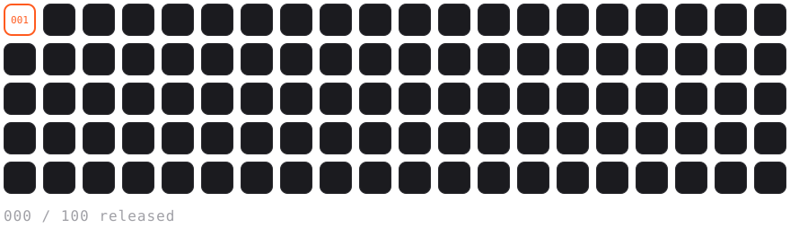

<picture>
  <source media="(prefers-color-scheme: dark)" srcset="assets/banner-dark.svg">
  <source media="(prefers-color-scheme: light)" srcset="assets/banner-light.svg">
  
</picture>

 

<code>WHO&nbsp;</code>&nbsp; Young builder. I turn ideas into products and put them in front of real people. 
<code>MAKE</code>&nbsp; Web apps, Telegram bots and mini apps, AI products, automations. 
<code>GOAL</code>&nbsp; 100 real businesses. The ones that prove themselves get released for free.

 
 

### The 100

Not 100 startup ideas. 100 honest attempts to get real users, keep what works, and hand it over so anyone can take it, build on it and launch it.

**Build → validate → document → release for free → repeat.**

<picture>
  <source media="(prefers-color-scheme: dark)" srcset="assets/grid-dark.svg">
  <source media="(prefers-color-scheme: light)" srcset="assets/grid-light.svg">
  
</picture>

 

### Right now

**Building in private.** Products in progress, none public yet. 
**Testing on real users.** Opinions don't count, usage does. 
**Writing it down.** Every business gets documented so it can be reused.

 

### Public work

**Nothing here yet, on purpose.** 
Everything is built and tested privately first. Slot `001` is reserved for the first one that earns its place on this page.

<!--
  ─────────────────────────────────────────────────────────────
  WHEN THE FIRST PROJECT GOES PUBLIC
  1. Replace the "Nothing here yet" paragraph above with one of
     the templates below. Delete the templates you don't use.
  2. Add the slot number to RELEASED in build_assets.py, run
     `python3 build_assets.py`, commit the new SVGs.
  ─────────────────────────────────────────────────────────────

  TEMPLATE: one featured project / business
  ──
  #### [Project name](https://github.com/ilyaxxing/REPO)
  One sentence: what it is and who it is for. 
  `slot 001` &nbsp; [Live](https://) · [Code](https://github.com/ilyaxxing/REPO) · [Case study](https://)

  TEMPLATE: two projects side by side
  ──
  <table>
    <tr>
      <td width="50%" valign="top">
        <code>slot 001</code> 
        <b><a href="https://github.com/ilyaxxing/REPO">Project A</a></b> 
        One sentence about it.
      </td>
      <td width="50%" valign="top">
        <code>slot 002</code> 
        <b><a href="https://github.com/ilyaxxing/REPO">Project B</a></b> 
        One sentence about it.
      </td>
    </tr>
  </table>

  TEMPLATE: case study line
  ──
  **[What happened with X](https://)**: one sentence on what was learned.
-->

 

### Working with

Claude Code · n8n · Make · Bolt · Railway · AI APIs

 

---

[Instagram](https://instagram.com/ilyaxxing) &nbsp;·&nbsp; [X](https://x.com/spvvqxn) &nbsp;·&nbsp; [Telegram](https://t.me/iiiLY4S)

