<picture>
  <source media="(prefers-color-scheme: dark)" srcset="assets/header-dark.svg">
  <source media="(prefers-color-scheme: light)" srcset="assets/header-light.svg">
  
</picture>

Web apps, Telegram bots and mini apps, AI things, automations, and small internet businesses.
This is where they get built.

 

### 100 businesses

A personal experiment. Build something real, see if people use it and pay for it, write down what happened. Do that a hundred times. 
The ones that work, I'll give away for free, so anyone can pick them up and launch their own.

<picture>
  <source media="(prefers-color-scheme: dark)" srcset="assets/progress-dark.svg">
  <source media="(prefers-color-scheme: light)" srcset="assets/progress-light.svg">
  
</picture>

 

### On the bench

Nothing public yet. 
A few things are half-built in private. They'll land here once they're worth showing.

<!--
  When something goes public, replace the two lines above with entries like this
  (and bump PUBLIC in build_assets.py, then run it):

  **[name](https://link)** &nbsp;live 
  One line about what it is.

  **[name](https://github.com/ilyaxxing/repo)** &nbsp;open source · 01 / 100 
  One line about what it is.
-->

 
 

  <a href="https://instagram.com/ilyaxxing">instagram</a> &nbsp;·&nbsp; <a href="https://t.me/iiiLY4S">telegram</a>

